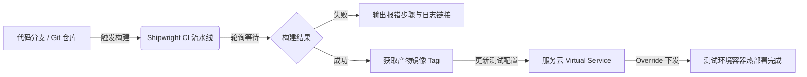

# 🚀 CI 构建与测试环境工作负载自动化部署参考手册

本手册为 **AI Agent** 提供贝壳内部持续集成平台（Shipwright）与服务云容器平台（Cloud Console）的底层 API 协议、鉴权机制、自动发现机制与交付安全规范。

---

## 🧭 一、核心自动化链路设计



整个闭环由 `scripts/ci_deploy.js` 统一调度，具备以下关键特性：
1. **纯自动化执行**：AI 根据用户自然语言一键触发，自动提取 Git 分支、轮询至镜像出炉、自动更新测试工作负载；
2. **新人零配置自发现 (Auto-Discovery)**：无需手动维护服务配置文件，支持动态调用 API 嗅探 CI 流水线与测试工作负载并自学习缓存；
3. **生产环境铁律隔离 (Advisor Mode)**：坚守安全底线，自动化部署仅限 `test` 环境，线上环境仅提供镜像建议单与官方控制台直达链接。

---

## 🔌 二、底层逆向 API 协议速查

### 1. Shipwright 构建流水线 API (shipwright.ke.com)

- **动态触发构建 (Dynamic Trigger)**
  - **URL**: `POST https://shipwright.ke.com/workflow-context/v1/workflows/{workflowId}/dynamic-trigger?overwrite=true`
  - **Headers**:
    ```json
    {
      "Content-Type": "application/json",
      "Cookie": "EGG_SESS=...; session_id=...;"
    }
    ```
  - **Body**:
    ```json
    {
      "triggerType": "MANUAL",
      "codeRepositories": [
        {
          "branch": "master"
        }
      ]
    }
    ```
  - **Response**:
    `{ "code": 0, "data": { "recordId": "6aa902..." } }`

- **轮询构建进度 (Workflow Records Query)**
  - **URL**: `POST https://shipwright.ke.com/workflow-context/v1/workflow-records/query?pageNumber=1&pageSize=5`
  - **Body**:
    ```json
    {
      "workflowId": "{workflowId}"
    }
    ```
  - **Status**: `RUNNING`, `SUCCESS`, `FAILED`, `ABORTED`

- **提取产物镜像 (Artifacts Query)**
  - **URL**: `POST https://shipwright.ke.com/workflow-context/v1/artifacts/query?pageNumber=1&pageSize=5`
  - **Body**:
    ```json
    {
      "recordId": "{recordId}"
    }
    ```
  - **Response Data**:
    `data[].artifactMeta.image`（例如 `hub.ke.com/smart-customer-service/smart-customer-service:202609181530-master-abcdef`）

---

### 2. 服务云工作负载部署 API (cloud.intra.ke.com)

- **获取当前测试工作负载配置 (Pre-deploy Config)**
  - **URL**: `GET https://cloud.intra.ke.com/cloud-proxy-api/cloud-application/app/{serviceId}/virtual-service/{workloadId}/edit`
  - **Headers**:
    ```json
    {
      "Cookie": "EGG_SESS=...; session_id=...; cloud_console_token_egg=..."
    }
    ```
  - **Key Fields**: `data.appVirtualService.virtualService.spec.containers[0].image`

- **下发工作负载更新 (Deploy Override)**
  - **URL**: `PUT https://cloud.intra.ke.com/cloud-proxy-api/cloud-application/app/{serviceId}/virtual-service/{workloadId}/override`
  - **Body**: 完整的更新后 virtualService 规格对象
  - **Response**: `{ "code": 0, "msg": "success" }`

- **查询历史构建镜像列表**
  - **URL**: `GET https://cloud.intra.ke.com/apis/ci/v1/deployment/images/{serviceId}?pageNumber=1&pageSize=10`
  - **Response**: 最近构建成功的镜像地址、创建时间、触发人等列表。

---

## 🧭 三、新人与未配置服务自动发现机制 (Auto-Discovery)

当用户指定了一个尚未在 `resources/default_services.json` 注册的微服务（例如新入职同学自研服务 `my-new-svc`）时，`ci_deploy.js` 将自动执行两步探测：

1. **探测 CI 流水线**：
   - 接口：`POST https://shipwright.ke.com/workflow-context/v1/workflows/query?pageNumber=1&pageSize=10`
   - 检索条件：在项目所属工作流中检索环境为 `test` 或名称包含 `my-new-svc` 的 workflow，提取 `workflowId`；
2. **探测测试工作负载**：
   - 接口：`GET https://cloud.intra.ke.com/cloud-proxy-api/cloud-application/app/{serviceId}/virtual-services`
   - 检索条件：筛选 `envType === 'test'` 的第一个工作负载，提取 `workloadId`（如 `env-my-new-svc-test-xxx`）；
3. **自学习静默沉淀**：
   - 校验探测到的 ID 有效后，自动写入 `~/.shrimp/skills/live-inspector/service_catalog.json`；
   - 下次执行无需重新探测，实现零配置自愈。

---

## 🔑 四、鉴权凭证规范与多系统通用机制

### 1. 为什么 `cloud_console_token_egg` 无法单独用于构建部署？
- `cloud_console_token_egg` 仅为服务云控制台内部部分接口（如 MySQL 自助查库）的校验 Token；
- `shipwright.ke.com`（持续集成）与 `cloud.intra.ke.com`（容器负载热更新）依赖内网统一 SSO 鉴权机制，接口网关严格检查 Cookie 中的 **`EGG_SESS`** 与 **`session_id`**；
- 若只传递 `cloud_console_token_egg`，Shipwright 会返回 `401 Unauthorized`，云控制台部署接口会返回 `302 Found` 重定向至登录页。

### 2. 通用解决方案：保存完整 Cookie
`leo-live-inspector` 支持将用户在浏览器控制台（F12）或 Chrome 扩展（**Leo cookie.txt Locally**）复制的完整 Cookie 字符串直接持久化保存至：
`~/.shrimp/skills/live-inspector/cloud_token.json`

- **一键更新命令**：
  ```bash
  node scripts/ci_deploy.js --set-cookie "EGG_SESS=...; session_id=...; cloud_console_token_egg=..."
  ```
- **双重兼容**：
  - `cloud_mysql_query.js` 自动从该完整 Cookie 中提取 `cloud_console_token_egg` 用于查库；
  - `ci_deploy.js` 将完整 Cookie 分别发送至 `cloud.intra.ke.com` 和 `shipwright.ke.com`；
  - **一次配置，查库与构建部署双通道同时生效！**

---

## 🛡️ 五、生产环境安全隔离铁律 (Advisor SOP)

生产环境绝不接受自动化非人工干预部署！当用户尝试发布到生产环境时：
1. **代码级硬拦截**：`ci_deploy.js` 包含生产环境断言，一旦检测到环境为 `prod` / `online` 立即抛出错误并退出；
2. **AI 参谋模式输出**：
   - 汇报当前构建好的镜像版本：`hub.ke.com/{app}/{app}:{tag}`；
   - 附带对应 Git Commit、分支与构建时间；
   - 提供服务云生产工作负载官方直达链接：
     ```text
     https://cloud.intra.ke.com/console/project/cloud/application/{serviceId}/virtual-service-list
     ```
   - 引导业务负责人在平台发起正规发布审批。

---

## 🛠️ 六、后端构建与部署 CLI 参数速查 (`scripts/ci_deploy.js`)

AI 后台执行 `node scripts/ci_deploy.js [serviceId] [options]`：

| 参数/选项 | 简写 | 默认值 | 说明 |
| :--- | :--- | :--- | :--- |
| `[serviceId]` | `-s, --service` | 自动识别 | 目标微服务 ID 或别名 (如 `smart-customer-service`, `saas`, `algo`)，未提供时自动根据当前本地 Git 仓库或目录识别 |
| `--branch` | `-b` | 自动识别 | 构建的代码分支，未提供时自动执行 `git rev-parse --abbrev-ref HEAD` 提取当前分支 (如 `master`, `main`, `feat/xxx`) |
| `--build-only` | - | `false` | 仅触发 Shipwright CI 构建并轮询镜像出炉，不执行工作负载部署 |
| `--deploy-only` | - | `false` | 仅执行测试环境工作负载镜像部署 (未显式指定 `--image` 时自动使用该微服务最近构建成功的镜像) |
| `--image` | `-i` | `null` | 显式指定部署的目标镜像完整地址 (如 `hub.ke.com/smart-customer-service/...:tag`) |
| `--list-images` | `-l` | `false` | 查询并列出该微服务历史构建成功的镜像列表、版本 Tag 与生成时间 |
| `--dry-run` | - | `false` | 安全预检模式，仅解析并打印识别到的 CI 流水线、工作负载配置与分支信息，不发起实际写操作 |
| `--timeout` | - | `15m` | 构建轮询最大超时时间 (支持 `10m`, `900s` 等) |
| `--set-cookie` | - | - | 手动保存服务云 Cookie 至本地缓存 |
| `--set-shipwright-cookie` | - | - | 手动保存 Shipwright 独立 Cookie |
| `--json` | - | `false` | 输出纯 JSON 数据结果 |

### ⚠️ 构建器选择避坑实战经验 (Builder Selection Pitfalls)
1. **已删除构建器残影**：Shipwright 的 `workflows/query` 列表**会返回已删除的构建器**（`app-svc_ke_com/deleted=1`），且残影可能排在列表前列。`ci_deploy.js` 的嗅探逻辑已内置过滤，但 AI 手动查询构建器列表时**必须核对 `deleted`/`cleared` 标签**，否则会选到废构建器（如 `zulin-iot-platform----测试环境构建` 已删但排首位，名字与有效的 `zulin-iot-platform----测试构建` 仅差"环境"二字）；
2. **同名/近名构建器辨识**：一个服务名下常有 20+ 个构建器（发二方包、公共库、手工传包通道等）。判断依据按优先级：`env` 标签 = `test` > 名称含"测试构建" > 其他。**api 二方包发布构建器（`iot-platform-api发包`）与服务部署构建器是两回事**，只有改动 api 模块对外契约时才需要前者；
3. **`--build-only` 不需要工作负载**：仅构建模式下只校验构建器存在，测试工作负载可以缺失（部署前会提前退出）；完整流水线才要求两者齐备；
4. **服务云查询走统一凭证通道**：查工作负载等云平台 API 必须用 `scripts/common/credentials.js` 的 `loadCloudCookie()`（读 `~/.shrimp/skills/live-inspector/cloud_token.json`），**不要手动拼接其他 cookie 文件**（如 `luke_cookie.json` 对 cloud.intra.ke.com 无效，会误判为"无权限"）；
5. **构建挂到废构建器上仍可能"成功"**：已删除构建器上触发的构建记录仍会正常执行并产出镜像（实测 SUCCESS），但产物可信度存疑——发现选错构建器后应改用有效构建器重新构建，以有效构建器的产物为准。

---

## 🌐 七、前端微服务通用构建与服务云交付引擎 (`scripts/feci_deploy.js`)

全面支持贝壳全量前端微服务（IOT、JZ、ZK、HT 等所有技术栈）的自动化 FeCI 构建、服务云工作负载容器更新与 CDN 静态资源同步：

### 1. CLI 参数与选项
| 参数/选项 | 简写 | 默认值 | 说明 |
| :--- | :--- | :--- | :--- |
| `[appName\|jobId]` | - | 自动识别 | 目标前端项目名 (如 `smart-customer-service-fe`, `iot-platform-fe`) 或 FeCI 任务 ID (如 `1282`)，未提供时自动从本地 Git 仓库识别 |
| `--branch` | `-b` | 自动提取 | 构建的代码分支，默认读取本地当前 Git 分支 (`master`, `feat/xxx`) |
| `--env` | `-e` | `test` | 目标发布环境类型（默认: `test`，严格拦截生产环境 `prod` / `online`） |
| `--deploy-only` | - | `false` | **纯部署模式**：跳过 FeCI 代码构建，直接选取最近构建产物下发服务云测试工作负载与 CDN 发布 |
| `--ci-only` | - | `false` | **纯构建模式**：仅执行 FeCI 流水线构建与产物归档，不触发服务云工作负载部署 |
| `--search` | `-s` | `null` | 搜索 FeCI 平台上的所有任务与流水线 (如 `-s "customer-service"`) |
| `--list` | `-l` | `false` | 查看该任务最近的历史构建记录与触发人、耗时 |
| `--dry-run` | - | `false` | 安全预检模式，仅打印任务名称、代码仓库、构建环境与分支，不触发实际构建与部署 |
| `--set-cookie` | - | - | 保存更新 FeCI 平台 (`feci-next.ke.com`) 独立 Session Cookie 凭证 |
| `--set-cloud-cookie` | - | - | 保存更新服务云平台 (`cloud.intra.ke.com`) 统一 Session Cookie 凭证 |

### 2. 零硬编码与跨工程全流程闭环
1. **自动感知**：任意前端工程根目录下执行 `node scripts/feci_deploy.js`，自动识别当前工程与 Git 分支；
2. **动态嗅探**：通过 FeCI 官方 API（`GET /api/job/list`）动态匹配代码仓库与项目名推导流水线 Job ID；
3. **构建联动交付**：构建成功后，自动直连服务云交付中心（`PUT /apis/cloud-application/app/:serviceId/virtual-service/delivery`），一键更新测试工作负载容器镜像并同步 CDN 静态资源；
4. **本地自学习**：探测验通后自动持久化到 `~/.shrimp/skills/live-inspector/feci_catalog.json`，实现越用越快、全公司前端工程通用。
