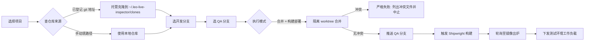

# 🖥️ 测试环境「合并 QA 分支并部署」可视化控制台

面向人工操作的一站式本地控制台：**选项目 → 选开发分支 → 合并进 QA 分支 → 推送远程 → 触发 Shipwright 构建 → 下发测试环境部署**，全程页面内可视化日志。AI 后台执行 `node scripts/deploy_web.js [options]`，默认地址 `http://127.0.0.1:6886`。

---

## 🧭 一、启动与参数

| 参数/选项 | 默认值 | 说明 |
| :--- | :--- | :--- |
| `--port` | `6886` | 本地监听端口（仅监听 `127.0.0.1`） |
| `--open` | - | 启动后用系统默认浏览器自动打开控制台 |

```bash
node scripts/deploy_web.js --open          # 启动并打开页面
node scripts/deploy_web.js --port 6899     # 换端口，避免与已在跑的实例冲突
```

启动时会对内联页面脚本做一次语法自检，日志里出现 `✅ 页面脚本自检通过` 才说明页面可用。

---

## 🔗 二、核心执行链路



**执行模式**：`合并 + 构建部署`（默认）、`直接部署开发分支`、`仅合并到 QA 分支`、`仅构建部署`、`仅构建`、`仅预演合并`。

---

## 📋 三、项目清单与仓库来源

项目清单**只来自「已登记 git 地址」**，不再扫描本机所有服务目录与 Git 仓库：

| 登记位置 | 用途 |
| :--- | :--- |
| `resources/project_repos.json`（skill 内置） | 团队通用登记 |
| `~/.shrimp/skills/live-inspector/project_repos.json`（用户可扩展） | 个人补充，优先级更高 |

登记格式（`git` 必填，`note` 可选）：

```json
{
  "zulin-iot-platform": {
    "git": "https://git.lianjia.com/rent_plat/iot-platform.git",
    "note": "IoT 平台主服务，测试环境走 qa-YYYY-MM 月度分支"
  }
}
```

- **已登记项目免本地检出**：服务自动托管克隆到 `~/.leo-live-inspector/clones/<project>`，只克隆对象库不检出工作区，合并时再按需 worktree 检出；
- **未登记服务名**仍可在项目框手输，回退到本地路径扫描（找不到会提示登记或手填路径）。

---

## 🎛️ 四、下拉交互设计（易踩坑的两处）

| 控件 | 策略 | 原因 |
| :--- | :--- | :--- |
| **项目下拉** | **不做搜索过滤**，点击或输入都展开全量已登记清单 | 原生 `<datalist>` 会按输入实时过滤，一旦输入的字对不上任何项，下拉直接整个消失 → 用户感知为「输入后就没法选了」 |
| **开发分支 / QA 分支下拉** | **保留关键字搜索** | 单服务动辄数百个远程分支，不搜索无法定位 |
| 两者共同 | 点击时全选「记住的上次值」，直接输入即整段替换 | 否则输入会拼在旧值后面（`org_pull_update` + `qa-2026` = 搜不到任何分支） |
| 项目框失焦 | 敲了半截就离开时，先确认本机是否有对应仓库；没有则**回退原项目** | 避免误触切走、把已加载的分支列表清空 |

---

## 🌿 五、分支形态识别

测试环境实际使用的是**最新的月度 QA 分支**，两种命名都支持并自动取最新的一支：

- `qa-YYYY-MM`，如 `qa-2026-11` → 提示「✅ 月度 QA 分支」
- `qa-YYYY-M-D`，如 `qa-2026-8-28` → 同样识别

非月度形态（如固定的 `qa`、`release/xxx`）会给出 ⚠️ 提示，避免选错分支把代码合到错误位置。

---

## 🔒 六、安全边界

1. **冲突策略固定「严格失败」**：合并出现冲突立即中止并列出冲突文件，**不自动改代码、不推送、不部署**；QA 分支受保护时在推送处提示改走 MR；
2. **隔离执行**：合并在独立的临时 worktree 中完成，不影响用户当前正在编辑的工作目录；
3. **仅限测试环境**：生产环境不提供自动化部署入口，需走线上变更参谋流程（见 [ci-deploy-guide.md](ci-deploy-guide.md)）。

---

## 💾 七、状态持久化

| 文件 | 内容 |
| :--- | :--- |
| `~/.shrimp/skills/live-inspector/deploy_ui_state.json` | 最近一次项目 / 开发分支 / QA 分支选择、手动仓库路径 |
| `~/.shrimp/skills/live-inspector/deploy_jobs/` | 历史任务记录（服务重启后仍可回看上次执行日志与失败原因） |
| `~/.leo-live-inspector/clones/` | 托管克隆的裸仓库 |

刷新页面会自动回填上次选择；页面底部的执行日志会在重启后恢复最近一次任务，便于复盘失败原因。
