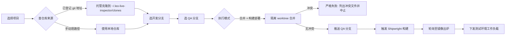

# 🖥️ 测试环境控制台（部署 · 日志 · Apollo · ONES · 写操作 · 凭据）

面向人工操作的本地一站式控制台，按 Tab 分为首页（能力导航）、部署、日志检索、Apollo 配置、ONES 研发、写操作、凭据七块。AI 后台执行 `node scripts/deploy_web.js [options]`，默认地址 `http://127.0.0.1:6886`。

| Tab | 能力 | 复用的脚本 |
| :--- | :--- | :--- |
| **首页** | 七张能力卡片 + 安全边界说明，卡片可直接跳转到对应 Tab | - |
| **部署** | 合并 QA → 推送 → Shipwright 构建 → 下发测试环境；右侧「最近任务」可回看任意历史日志 | `ci_deploy.js` |
| **日志检索** | 测试环境容器日志 / 生产 FAST-Kibana（只读），按服务+关键词+级别+时间窗查 | `test_log_query.js` / `fast_query.js` |
| **Apollo 配置** | 配置速查（支持 test/preview/prod 只读）与配置项发布轨迹 | `apollo_query.js` / `apollo_history.js` |
| **ONES 研发** | 我的排期（默认本周，可翻周；**首次进入自动查一次**）、需求详情、需求检索、缺陷检索、迭代/项目；写入子页含新建需求/缺陷、改排期、移入迭代、状态流转 | `ones_query.js` / `ones_modify.js` |
| **写操作** | Apollo 改值与发布、ES 文档改删、Kafka 投递、测试库 SQL —— 全部「预检 → 确认」两步 | `apollo_modify.js` / `es_modify.js` / `kafka_send.js` / `test_mysql_query.js` |
| **凭据** | 17 项 Cookie / Token 台账（4 个分组）：状态、更新时间、Cookie 名；一键刷新（需登录时在你当前窗口打开普通标签页，登录后自动回读落盘）、手动粘贴、清除、探活 | `credential_relay.js`（本地桥接） |

---

## 🎨 一、外观与主题（玻璃拟态）

界面采用玻璃拟态（Glassmorphism）：深色渐变背景 + 模糊彩色光斑 + 半透明毛玻璃卡片。

| 元素 | 实现 |
| :--- | :--- |
| 背景 | `linear-gradient(158deg, #0f172a, #1e293b)` + 三处径向渐变光晕 |
| 光斑 | 三个 `radial-gradient` 柔边彩色圆（**不用 `filter:blur()`**），静态不浮动 |
| 卡片 | `rgba(255,255,255,.075)` + `border: 1px solid rgba(255,255,255,.2)` + 投影与内高光 |
| 光影 | 外层 `box-shadow` 投影 + 内层 `inset 0 1px 0 rgba(255,255,255,.16)` 高光，hover 时换成强调色辉光 |
| 字体 | 标题 26px/800 字重；关键数据用 `background-clip:text` 渐变填充 |
| 动画 | 页面切换时 `fadeInUp 0.5s cubic-bezier(.22,1,.36,1)` |

### ⚠️ 玻璃拟态的滚动性能红线

玻璃感靠**半透明色值**实现，不靠 `backdrop-filter`。以下几类写法会让滚动逐帧重算，用户会看到白块闪烁、卡顿、白色区域「放大一下」——已经踩过一次，别再写回去：

| 禁用 | 为什么会卡 |
| :--- | :--- |
| `backdrop-filter` / `-webkit-backdrop-filter` | 每帧对背后区域重新采样模糊；面积越大越致命，铺满整屏的卡片是最坏情况 |
| `position:sticky` + `backdrop-filter` | 吸顶元素滚动时持续重采背后内容 |
| `background-attachment: fixed` | 整页背景在每次滚动时重绘而不是随内容移动 |
| `filter: blur(...)` 的光斑层 | 大半径模糊 + 动画，每次合成都要重算 |
| 带 `backdrop-filter` 的元素上做 `transform` / 位移 hover | 位移触发重新栅格化，视觉上就是「卡片突然变大」 |

替代做法：卡片用 `--glass-card`、胶囊导航用 `--glass-nav`、浮层（下拉/Toast）用 `--glass-pop` 三个不透明度更高的令牌，视觉上仍是磨砂玻璃，滚动时零成本。`tests/ones-autoquery.test.mjs` 里有一条 `滚动性能：不使用 backdrop-filter ...` 的回归用例守着这条线。

**吸顶 Tab 栏必须是实色**：去掉 `backdrop-filter` 后，`rgba(...,.97)` 这类高但不等于 1 的透明度仍会让下方滚动的白字透上来，视觉上就是「白块 / 文字重影」。`--glass-nav` 直接给十六进制实色。另外 `top:14px` 留出的那条 14px 缝隙也会漏出滚动内容，用 `.tabs::before`（`background: var(--nav-gap)`）向上补满。

**入场动画不要 `fill-mode: both`**：`.page.active { animation: fadeInUp .5s }` 的结束态与元素自然状态一致，加 `both` 只会让整页永久停留在一个合成层里，滚动时反复重绘超大 layer。

`background` 的渐变也搬到了 `.bg-decor`（`position:fixed` + `contain:strict` + `translateZ(0)`），让它独立成一个合成层，滚动不再重绘 body。

### 亮色 / 暗色主题

两套主题**共用一套 CSS 变量**，只有 `:root`（暗色）与 `html[data-theme="light"]`（亮色）里的令牌值不同，所以加新组件时用变量即可自动适配两套主题。

| 行为 | 说明 |
| :--- | :--- |
| 默认 | 跟随系统 `prefers-color-scheme` |
| 手动切换 | 右上角按钮，图标 🌙暗色 / ☀️亮色 |
| 持久化 | 存 `localStorage['leo.theme']`，下次打开沿用 |
| 防闪烁 | `<head>` 里有一段同步内联脚本，在首帧前把 `data-theme` 写到 `<html>` 上 |
| 强制指定 | URL 加 `?theme=light` / `?theme=dark`，可截图或分享固定主题的链接 |

**注意**：页面现在有两个内联 `<script>`（head 主题脚本 + 主体脚本）。启动自检会逐个校验，正则用非贪婪的 `/<script>([\s\S]*?)<\/script>/g` 收集全部——早期用贪婪匹配会把两段之间夹着的 `</script><script>` 一起吞进去，拼出非法代码，自检会误报失败。

---

## 🧭 一、启动与参数

| 参数/选项 | 默认值 | 说明 |
| :--- | :--- | :--- |
| `--port` | `6886` | 本地监听端口（仅监听 `127.0.0.1`） |
| `--open` | - | 启动后用系统默认浏览器自动打开控制台 |

```bash
node scripts/console.js                   # 推荐：幂等启动，并在系统默认浏览器里打开页面（默认 6886）
node scripts/deploy_web.js --open          # 仅一个实例时可用；端口被占用会 EADDRINUSE 退出
node scripts/deploy_web.js --port 6899     # 换端口，避免与已在跑的实例冲突
```

**打开浏览器是默认行为**：`console.js` 起完服务会调系统默认浏览器（macOS `open` / Windows `start` / Linux `xdg-open`）把页面弹出来，不需要用户再手点一次地址。`--json` 输出里的 `opened` 取自该命令的真实退出码，失败时附 `openError`——不要把 `opened:false` 当成成功来报。

### 启动器 `console.js`（推荐）

`deploy_web.js` 在端口被占用时会直接 `EADDRINUSE` 退出。`console.js` 包了一层，解决这个日常摩擦：

| 场景 | 行为 |
| :--- | :--- |
| 端口已有控制台在跑，且代码一致 | **复用**，直接打开浏览器，不再起第二个 |
| 端口空闲 | 后台拉起 `deploy_web.js`（`detached`，脱离进程组），等 `/api/initial` 就绪后打开浏览器 |
| 端口已有控制台在跑，但跑的是旧代码 | **拒绝静默复用**（退出码 2），提示用 `--restart` |
| 端口被别的程序占用 | 明确报错并提示换端口（会校验 `/api/initial` 确认是不是本控制台） |
| `--restart` | 确认进程是 `deploy_web.js` 后停掉，再用当前磁盘代码拉起并打开浏览器 |
| `--no-open` | 只起服务，不弹浏览器（用户明确要求时才用） |
| `--stop` | 按记录的 PID 停掉本脚本启动的实例 |

```bash
node scripts/console.js --port 6901        # 指定端口
node scripts/console.js --no-open          # 只启动，不弹浏览器
node scripts/console.js --restart          # 改完代码后重启，加载新版本
node scripts/console.js --stop             # 停止
node scripts/console.js --json             # 结构化输出（含 url/pid/buildId/log/stop）
```

产物：PID 记在 `~/.shrimp/skills/live-inspector/console.pid`（非默认端口为 `console-<port>.pid`），日志写到同目录 `console.log`。PID 文件按端口分开，避免同时开多个实例时 `--stop --port` 停错进程。

### 版本指纹与「改了没生效」

`deploy_web.js` 的页面 HTML 与路由处理函数都在模块加载时固化进内存，**改文件后必须重启进程**才生效。`/api/initial` 因此会返回两个字段：

| 字段 | 含义 |
| :--- | :--- |
| `buildId` | 该进程启动时算出的代码指纹（`deploy_web.js` + `common/**.js` 内容的 SHA1 前 10 位） |
| `pid` | 进程号 |

`console.js` 探测到端口有实例时，会把响应里的 `buildId` 与磁盘上现算的指纹比对：

- 一致 → 复用；
- 不一致（或旧版本没有该字段）→ 判定为「进程活着但跑的是旧代码」，**拒绝静默复用**，退出码 2，并提示 `--restart`。

指纹用文件**内容**计算而非 mtime：同步/拷贝文件会刷新 mtime 但内容可能不变，用 mtime 会产生无意义的重启。

这解决的就是「打开 6886 看不到新功能」这类问题——以前只能靠人肉发现端口上挂着的是十几分钟前启动的老进程。

**仍然不会自动启动**：没有 postinstall、没有 launchd/systemd 守护，系统重启后消失。要「打开就有」，必须有人或 AI 显式执行上面的命令。

启动时会对内联页面脚本做一次语法自检，日志里出现 `✅ 页面脚本自检通过` 才说明页面可用。

---

## 🔌 二、新增 Tab 的后端契约

页面自身的脚本只做「收参数 → 拼 CLI → 呈现结果」，不重建业务逻辑。所有 `POST /api/*` 都以 `--json` 调起脚本，返回值统一为：

```json
{ "ok": true, "json": { }, "stdout": "...", "stderr": "...", "message": "..." }
```

`ok=false` 时 `error` 字段给出可读原因（脚本原文或退出码）。脚本执行有 120–180 秒超时兜底，超时会杀掉子进程而不是把页面请求一起挂死。

| 路由 | 作用 |
| :--- | :--- |
| `POST /api/verify` | 部署后验活：拉近 N 分钟 `ERROR` 日志 |
| `POST /api/logs` | `source=test` 走 Loki，`source=prod` 走 FAST（只读） |
| `POST /api/apollo/query` / `/history` | 配置速查 / 发布轨迹 |
| `POST /api/ones/query` | ONES 只读：`schedule` / `req` / `reqs` / `bugs` / `iterations` / `projects` |
| `POST /api/ones/write` | ONES 写入：`confirm=false` 预检，`confirm=true` 才落库 |
| `POST /api/write/apollo\|es\|kafka\|mysql` | `confirm=false` 预检，`confirm=true` 才写入 |
| `GET /api/apps` | 服务名候选清单（来自 service catalog） |
| `GET /api/initial` | 页面初始化态；含 `buildId`（当前进程代码指纹）与 `pid`，供启动器判断版本是否过期 |
| `GET /api/credential-list` | 凭据台账（只读元信息，不返回凭据值） |
| `POST /api/credential/refresh` | 打开站点并回读 Cookie，登录完成后自动落盘 |
| `POST /api/credential/open` / `save` / `clear` / `probe` | 打开登录页（用户窗口的普通标签页） / 手动粘贴 / 清除 / 探活 |

**环境锁死**：每个写操作路由都在服务端硬钉测试环境（`-e test` / `--env TEST`），不接受前端传入的其他环境值，生产写入在后端就被物理拦截。

**ONES 例外（协作系统）**：ONES 没有测试环境，全部是真实研发数据，因此不受上面这条「生产只读」约束。它的写入仍走两阶段：`confirm=false` 只跑 `ones_modify.js` 的 Dry-Run 并回显预审单，`confirm=true` 才带 `--confirm`。页面里对该 Tab 单独标注了这一点，避免与「仅测试环境」的全局说明混淆。

**两步确认的落地方式**：
- Apollo / ES / MySQL / ONES 走脚本原生 Dry-Run（不带 `--confirm` 只输出 Diff）；
- Kafka 没有原生 Dry-Run，`confirm=false` 时服务端只回显将要发送的 topic / key / 消息体；
- MySQL 的 `SELECT/SHOW/DESC/EXPLAIN` 视为只读直接执行，其余语句必须 `confirm=true`，且服务端只允许单条语句，防止一次提交塞进多段写入绕过确认。

**ONES 缺陷标题搜索的坑**：`get_bugs` 服务端会把 `summary` / `kw` / `title` / `search` 全部静默忽略并返回全库 3.5 万条，且每页固定 10 条、`limit` 不生效。所以 `listBugs` 改成翻页扫描最近 600 条再本地做子串匹配，返回里的 `scanned` 就是实际扫描量——更早的缺陷搜不到，这类情况请改用 ID 或处理人。

---

## 🔑 三、凭据 Tab：查看与「点一下就刷新」

skill 全部能力都依赖内网站点登录态。凭据 Tab 把 `~/.shrimp/skills/live-inspector/` 下的 17 个凭据文件集中成一张台账。

**页面只展示元信息**：是否存在、`updated_at`、Cookie 名列表与数量。**任何 Cookie / Token 的值都不会出现在页面上**，也不会出现在接口返回里。

| 操作 | 行为 |
| :--- | :--- |
| **刷新** | 先用浏览器现有 Cookie **静默探活**：通过就直接落盘，完全不动你的窗口。不通过才在**你当前正在用的 Chrome 窗口**里打开该站点的一个普通标签页（不建标签组、不另开窗口），页面每 3 秒重读一次，**你登录完成后自动落盘，不用再点第二次**（等待上限可选 45 秒 / 2 分钟 / 5 分钟） |
| **打开登录页** | 只打开一个普通标签页，不写任何文件。再次打开同一个站点会**复用扩展自己开过的那一个标签**导航，不会堆一串标签页；**用户自己开的标签页永远不会被导航或关闭** |
| **粘贴保存** | 手工兜底：接受 Cookie 头、Netscape `cookies.txt`、JSON 三种格式 |
| **清除** | 删除本机凭据文件（确认后执行） |
| **探活** | 用已保存 Cookie 打一次该站点真实接口，判定「正常 / 需重新登录」 |
| **刷新全部已登录站点** | 依次刷新所有已保存的 Cookie 凭据，适合长期没登录后一次性补齐 |

**普通标签页 vs 任务分组**：登录页走扩展的 `tabs.open`（扩展 1.4.3 起），就是用户平时点 `+` 号开一个标签页——落在你当前激活的窗口里，不建标签组、不开独立窗口、不占用扩展的任务位。标签归属记在 `chrome.storage.local`，所以扩展重载后仍然认得出「这个是我开的」：同一站点再次打开只导航这一个标签，不会把你的页面导航走，也不会关闭你自己的标签。任务标签分组（`task.start` / `new-tab`）只用于 Agent 自己跑自动化测试，不参与面向用户的这些按钮。扩展低于 1.4.3 时会提示去 `chrome://extensions` 重新加载。

台账覆盖范围：

| 分组 | 凭据 |
| :--- | :--- |
| 构建部署 | Shipwright、服务云/CI（`cloud_token.json`）、FeCI |
| 配置中心 | Apollo 测试、Apollo 生产 |
| 权限与网关 | Luke 测试/生产、白鸽网关 测试/预发/生产、UC 测试 |
| 数据查询 | 搜索云 ES、FAST、Paoding Loki、灯塔 ARMS（Cookie + API Key）、Dinsight |

**探活判据**：HTTP 401/403、重定向到登录页、接口返回 `"code":401`、HTML 里 JS 跳登录（`location.replace("//login.ke.com/...")`）、`not_authenticated` 文案，任一命中即判定登录态失效。API Key 类凭据无法从浏览器读取，只能手动粘贴。

**刷新守门（重要）**：浏览器里可能只剩埋点 Cookie，读到 Cookie 不代表登录有效。因此刷新会**先用读到的 Cookie 探活，通过后才写盘**；不通过就继续等你在 Chrome 里登录，超时则报「未确认到有效登录态（原有凭据未改动）」——避免一次无效刷新把原本可用的凭据覆盖坏。

**刷新失败的三种情况**：桥接没连上（Chrome 未启用扩展「Leo cookie.txt Locally」）直接报错；等待超时说明登录没完成，页面提示重试；站点没有探活接口时会直接落盘（只报同步了几个 Cookie）。

---

## 🔗 四、核心执行链路



**执行模式**：`合并 + 构建部署`（默认）、`直接部署开发分支`、`仅合并到 QA 分支`、`仅构建部署`、`仅构建`、`仅预演合并`。

---

## 📋 五、项目清单与仓库来源

项目清单**只来自「已登记 git 地址」**，不再扫描本机所有服务目录与 Git 仓库：

| 登记位置 | 用途 |
| :--- | :--- |
| `resources/project_repos.json`（skill 内置） | 团队通用登记 |
| `~/.shrimp/skills/live-inspector/project_repos.json`（用户可扩展） | 个人补充，优先级更高 |

登记格式（`git` 必填，`note` 可选）：

```json
{
  "zulin-iot-platform": {
    "git": "https://git.lianjia.com/rent_plat/iot-platform.git",
    "note": "IoT 平台主服务，测试环境走 qa-YYYY-MM 月度分支"
  }
}
```

- **已登记项目免本地检出**：服务自动托管克隆到 `~/.leo-live-inspector/clones/<project>`，只克隆对象库不检出工作区，合并时再按需 worktree 检出；
- **未登记服务名**仍可在项目框手输，回退到本地路径扫描（找不到会提示登记或手填路径）。

---

## 🎛️ 六、下拉交互设计（易踩坑的两处）

| 控件 | 策略 | 原因 |
| :--- | :--- | :--- |
| **项目下拉** | **不做搜索过滤**，点击或输入都展开全量已登记清单 | 原生 `<datalist>` 会按输入实时过滤，一旦输入的字对不上任何项，下拉直接整个消失 → 用户感知为「输入后就没法选了」 |
| **开发分支 / QA 分支下拉** | **保留关键字搜索** | 单服务动辄数百个远程分支，不搜索无法定位 |
| 两者共同 | 点击时全选「记住的上次值」，直接输入即整段替换 | 否则输入会拼在旧值后面（`org_pull_update` + `qa-2026` = 搜不到任何分支） |
| 项目框失焦 | 敲了半截就离开时，先确认本机是否有对应仓库；没有则**回退原项目** | 避免误触切走、把已加载的分支列表清空 |
| 日志/Apollo/写操作的服务名框 | 用**关键字搜索**，候选来自 service catalog（56 个主键与别名） | 服务名与口语别名都能直接搜到（`warehouse`、`门锁`、`iot`） |

### 执行日志的「智能跟随」

轮询每 1.2 秒刷新一次日志，**不是无脑滚到底**：

| 用户行为 | 日志区表现 |
| :--- | :--- |
| 停留在底部（距底 ≤ 48px） | 自动跟随新日志滚到底，无需手动下滑 |
| 往上翻看历史 | **立即停止跟随**，新日志进来时视口纹丝不动（保持 `scrollTop` 不变） |
| 停止跟随时 | 标题右侧出现「已暂停自动跟随 · 回到最新」提示 |
| 点「回到最新」/ 手动滚回底部 | 恢复跟随并贴底 |
| 首次打开页面 / 提交新任务 | 重置为跟随并贴底，保证一眼看到最新进度 |

实现要点：旧实现每轮轮询都执行 `scrollTop = scrollHeight`，导致用户永远无法上翻；现改为监听 `scroll` 事件维护 `logStick` 状态，并只在文本真正变化时重写 `textContent`（避免重置滚动位置与选区）。

---

## 🌿 七、分支形态识别

测试环境实际使用的是**最新的月度 QA 分支**，两种命名都支持并自动取最新的一支：

- `qa-YYYY-MM`，如 `qa-2026-11` → 提示「✅ 月度 QA 分支」
- `qa-YYYY-M-D`，如 `qa-2026-8-28` → 同样识别

非月度形态（如固定的 `qa`、`release/xxx`）会给出 ⚠️ 提示，避免选错分支把代码合到错误位置。

---

## 🔒 八、安全边界

1. **冲突策略固定「严格失败」**：合并出现冲突立即中止并列出冲突文件，**不自动改代码、不推送、不部署**；QA 分支受保护时在推送处提示改走 MR；
2. **隔离执行**：合并在独立的临时 worktree 中完成，不影响用户当前正在编辑的工作目录；
3. **部署与写操作仅限测试环境**：生产部署不提供自动化入口，需走线上变更参谋流程（见 [ci-deploy-guide.md](ci-deploy-guide.md)）；
4. **生产只读**：日志检索与 Apollo 速查允许选 prod，但只给「查」不给「写」；页面没有任何生产写入入口，后端路由也硬钉测试环境；
5. **写操作两步确认**：预检只展示 Diff / 回显，未点「确认提交」绝不落库；SQL 单条语句上限与无 WHERE 拦截由脚本层继续生效。

---

## 💾 九、状态持久化

| 文件 | 内容 |
| :--- | :--- |
| `~/.shrimp/skills/live-inspector/deploy_ui_state.json` | 最近一次项目 / 开发分支 / QA 分支选择、手动仓库路径 |
| `~/.shrimp/skills/live-inspector/deploy_jobs/` | 历史任务记录（服务重启后仍可回看上次执行日志与失败原因） |
| `~/.leo-live-inspector/clones/` | 托管克隆的裸仓库 |

刷新页面会自动回填上次选择；页面底部的执行日志会在重启后恢复最近一次任务，便于复盘失败原因。

### ONES「我的排期」何时自动查询

一次查询要 3~5 秒，所以只在**结果还是空的**时候自动补一次，查过就不再重复请求：

| 时机 | 行为 |
| :--- | :--- |
| 首次进入 ONES 页 | 结果区为空 → 自动按本周查一次 |
| 切换子页后回到「我的排期」 | 已查过 → 原样保留，不重新请求 |
| 上次查询失败 | 视为没查过 → 下次进入自动重试 |
| 手动改完日期 | 不会自动查，仍以点「查询排期」为准 |
| 点快捷区间 / 翻上一周、下一周 | 按钮本身就会触发查询 |

### 快捷时间窗

| 按钮 | 区间 | 用途 |
| :--- | :--- | :--- |
| 本周 | 本周一 ~ 本周日 | 默认视图 |
| 上一周 / 下一周 | 相对当前显示日期平移 7 天 | 以输入框里的日期为基准，不是全局偏移量 |
| 本月 | 本月 1 号 ~ 本月最后一天 | 月度全景 |
| 上一月 | 上个自然月完整区间 | 月度复盘 |
| 上周一 ~ 本周日 | 跨两个完整周（14 天） | 回看刚过去的冲刺尾巴 |
| 本周一 ~ 下周五 | 本周 + 下周工作日（12 天） | 提前看接续任务 |

月末用「下月 0 日」取，自动处理大小月与闰年。按钮高亮由当前日期窗反查得出，手改日期后自动取消高亮。

实现要点：`onesSchedLoaded` 记录成功渲染过的时间窗，`onesSchedInFlight` 防止并发重复触发；两者都清空才允许自动查询。
